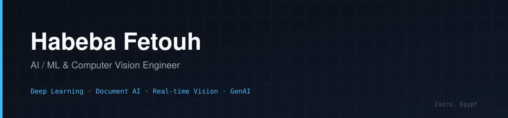

**Top Rated freelancer on Upwork** · Based in Egypt

---

## About

I design and build deep learning systems for detection, classification, and recognition. My focus is document AI and OCR, real-time computer vision, and GenAI applications. I handle the full lifecycle: data pipelines, model training, and deployment.

## Expertise

| Area | Tools |
|---|---|
| Computer Vision | OpenCV, PyTorch, TensorFlow, Keras |
| Document AI & OCR | Python, deep learning pipelines |
| Data & Experimentation | NumPy, Pandas, Jupyter |
| Web & Applications | TypeScript, React, Next.js |
| Engineering | Git, GitHub |

## Selected Work

| Project | Description | Stack |
|---|---|---|
| [Intelligent Document Vision – OCR](https://github.com/Habeba455/Intelligent_Document_Vision-OCR_System) | Document understanding and OCR pipeline | Python |
| [Real-Time Sign Language Recognition](https://github.com/Habeba455/Real_Time_Sign_Language_Recognition-Learning_System) | Live sign-language recognition and learning | Python |
| [Real-Time Face Detection](https://github.com/Habeba455/Deep-Learning-Real-Time-Face-Detection-ResNet50-DenseNet121) | Face detection with ResNet50 and DenseNet121 | Jupyter |
| [NEU Surface Defect Detection](https://github.com/Habeba455/NEU-Surface-Defect-) | Industrial surface defect classification | Python |
| [MineSafety](https://github.com/Habeba455/MineSafety) | Safety monitoring for mining environments | Python |
| [Homivio CRM](https://github.com/Habeba455/homivio-cod-crm) | CRM web application | TypeScript |

## Contact

[LinkedIn](https://www.linkedin.com/in/habebafetouh) · [Upwork](https://www.upwork.com/freelancers/~0158763b5d7af68350) · [Freelancer](https://www.freelancer.com/u/habebaftooh)
